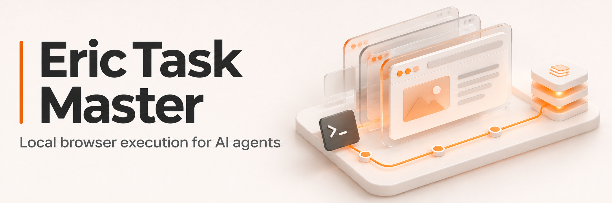

<p align="center">
  
</p>

# Eric Task Master 4.2.1

**Your Agent plans the work. Task Master keeps the browser work running.**

Durable local Chrome execution for terminal-capable AI Agents: one CLI for batch jobs, persistent operations, human takeover and retained results. Runs on your computer, using your selected Task Master Profile. The Agent supplies judgment; Task Master supplies execution and lifecycle control.

[](https://github.com/npcworkspace-cmyk/eric-task-master/releases/latest)
[](https://github.com/npcworkspace-cmyk/eric-task-master/actions/workflows/ci.yml)
[](#download)
[](LICENSE)

**[Download latest](https://github.com/npcworkspace-cmyk/eric-task-master/releases/latest)** · [简体中文](README.zh-CN.md) · [4.2.1 release notes](docs/releases/4.2.1.md) · [Task Master Skills](https://github.com/npcworkspace-cmyk/eric-task-master-task-pack-skill)

[Quick start](#quick-start) · [Modes](#two-execution-modes) · [Download](#download) · [Documentation](#documentation) · [NPC ↗](https://www.npctech.site/)

---

## Quick start

1. Get the runtime and matching Skill from **[Latest](https://github.com/npcworkspace-cmyk/eric-task-master/releases/latest)**. Install stable Google Chrome; Node.js and Playwright are included in the runtime. Already installed? [Check and upgrade in place](#installation-and-upgrades)—keep your Profiles and task data.
2. Run `taskmaster panel`, retain or select your default Profile, and give the [driving Skill](skills/eric-task-master/SKILL.md) to your Agent. Sign in manually only when your task needs it, then close the manual Profile window before automation.
3. Save a trusted `job.mjs` and run it with your verified launcher:

```js
export async function run({ page, input, outputDir, progress, signal }) {
  await page.goto(input.url, { waitUntil: 'domcontentloaded' });
  const title = await page.title();
  await progress({ current: 1, total: 1, message: 'Collected title' });
  return { title, outputDir, aborted: signal.aborted };
}
```

```bash
taskmaster run ./job.mjs --input '{"url":"https://example.com"}' --detach --json
taskmaster panel --json
taskmaster follow TASK_ID --wait-ms 60000 --json
taskmaster files TASK_ID --json
```

Replace `TASK_ID` with the returned ID; continue later `follow` calls with its `after` cursor. UTF-8 JSON files (`--input @ABSOLUTE_FILE`) avoid host-specific shell quoting. `panel --json` returns the Dashboard URL without opening a window.

## Two execution modes

| | `batch` | `operations` |
| --- | --- | --- |
| Best for | A known one-off or repeated script | Interactive steps, observation, conditions and scheduled events |
| Interface | Submit a small `.mjs` | Send bounded JSON commands through the same CLI |
| Lifetime | Ends when the finite job completes | Retains the task and Chrome context until stopped or a limit is reached |
| Shared foundation | Persistent Profile, progress and result files | Same Profile access, readback and durable action evidence |

An explicit mode in the task prompt applies only to that task and overrides the saved Profile default. Otherwise the Profile policy applies; `auto` selects from the declared Skill mode or waiting/follow-up intent, falling back to batch. `auto` is a selection policy, not a third execution engine.

Human takeover is a pause lock, not a mode. It keeps the browser, blocks automated mutation and requires explicit resume plus a fresh observation. Automation cannot release the takeover lock itself. A mode change never changes identity or permission.

## What's new in 4.2.1

| Change | What it means in practice |
| --- | --- |
| Compact decisions, complete evidence | Small current-command replies and explicit delta baselines; full receipts remain available without replaying actions |
| Stable native targets | References follow the original connected node rather than its old position; replaced or detached controls stop explicitly |
| Stronger dispatch boundaries | The original page/document/control binding survives confirmation waits; checks, waits and dispatch share one monotonic deadline |
| Current-scene reference retention | Both bounded caches keep controls returned in the current observation, even after extensive same-document changes |
| Persistent connection and handoff records | Keep one operation/Profile across CLI connections; a client without the old scene starts with a fresh observation |

These are execution and evidence guarantees within the documented boundaries—not universal website compatibility, AI-to-AI reasoning transfer, or exactly-once delivery by external services. See the [release notes](docs/releases/4.2.1.md), [output contract](docs/OPERATIONS-OUTPUT.md) and [persistence guide](docs/OPERATIONS-PERSISTENCE.md).

## Download

**New deployments start at [Latest](https://github.com/npcworkspace-cmyk/eric-task-master/releases/latest).** Select the runtime and Skill from that same release; do not substitute an old local archive. The names below describe 4.2.1. If Latest is newer, follow that release's guide and filenames instead. The [versioned 4.2.1 page](https://github.com/npcworkspace-cmyk/eric-task-master/releases/tag/v4.2.1) is a reproducible reference, not the default future deployment target.

| Platform | Native installer | Portable ZIP |
| --- | --- | --- |
| Windows 10/11 x64 | `eric-task-master-v4.2.1-windows-x64-setup.exe` | `eric-task-master-v4.2.1-windows-x64-portable.zip` |
| macOS Apple silicon | `eric-task-master-v4.2.1-macos-arm64.pkg` | `eric-task-master-v4.2.1-macos-arm64-portable.zip` |
| macOS Intel | `eric-task-master-v4.2.1-macos-x64.pkg` | `eric-task-master-v4.2.1-macos-x64-portable.zip` |
| Debian/Ubuntu x64 | `eric-task-master-v4.2.1-linux-x64.deb` | `eric-task-master-v4.2.1-linux-x64-portable.zip` |
| Debian/Ubuntu arm64 | `eric-task-master-v4.2.1-linux-arm64.deb` | `eric-task-master-v4.2.1-linux-arm64-portable.zip` |

Download the matching `eric-task-master-skill-v4.2.1.zip`, `SHA256SUMS` and `UNSIGNED-BUILD.txt` from the same release. Verify checksums before installation. Windows and macOS packages are unsigned; portable ZIPs do not bypass SmartScreen or Gatekeeper.

<a id="install"></a>

## Installation and upgrades

<details>
<summary><strong>Locate an existing installation, replace safely, and verify activation</strong></summary>

### Install 4.2.1

### 1. Locate an existing installation first

For a new Agent, **check for the Manager, install only if missing**. If the requested version is already deployed, **install/update only the Agent Skill**. Replace an older installation with authorization, not a second Manager or a replacement Profile pool; if work is active, let the Owner choose whether to wait or stop it.

To deploy or update through an Agent, give it the [latest release link](https://github.com/npcworkspace-cmyk/eric-task-master/releases/latest) and ask it to install or update Task Master and its matching Skill. The Agent should verify the release files and preserve existing state; if it cannot install or reload Skills in its host, it must report that limitation.

On Windows, use the Skill's [read-only launcher locator](skills/eric-task-master/scripts/find-launcher.ps1); on macOS/Linux, use the installed or known portable launcher. Verify the absolute launcher with `--help` and keep using that path. An unresolved location or state error is not permission to reinstall, merge state or recreate Profiles.

Agents running as the same OS user share one selected Manager and Profile pool by default. For an isolated project, explicitly pass `--state-dir ABSOLUTE_DIRECTORY` on every command. Normal startup reuses a matching running Manager; it does not silently replace a different version.

**An upgrade is complete only when the launcher, running Manager and installed driving Skill match.** An idle Manager can be stopped and replaced automatically. If it is busy, the Owner chooses whether to wait or explicitly stop its work and replace it; never force-stop by default. The new Manager synchronizes the selected installed Skill from its same-version bundle, retaining a backup. If the result says `not-installed`, import that Skill for the intended Agent. A nondefault Skill folder is selected with `ERIC_TASK_MASTER_SKILL_DIR`. Preserve existing Profiles, task records and outputs; see [installation](docs/INSTALLERS.md) and [state recovery](docs/STATE-BACKUP-RECOVERY.md).

The Manager rejects outdated clients before they create or change work. A recognized Agent whose Skill was refreshed must load the new instructions before retrying; each Agent acknowledges separately, while existing safe stop and read controls remain available. Installation alone is not activation. A known Windows `v3` launcher path is converted to a forwarding entry so an older terminal reaches the current installation; unknown or unsafe paths are not silently changed.

The Windows replacement installer attempts activation automatically; exit code 20 means the files were installed but activation is incomplete. Other packages and retries use the new absolute launcher with `manager start --upgrade --json`. Verify the running Manager and selected Skill rather than inferring completion from a successful file copy.

### 2. Download the matching runtime and Skill

Install stable Google Chrome and choose the current platform package from [Latest](https://github.com/npcworkspace-cmyk/eric-task-master/releases/latest). Use the [download table](#download) to identify the package type; never combine a newer runtime with an older Skill archive.

Also download **`eric-task-master-skill-v4.2.1.zip`**, `SHA256SUMS` and `UNSIGNED-BUILD.txt` from the same release. Verify checksums before installation. Windows and macOS packages are unsigned; portable ZIPs do not bypass SmartScreen or Gatekeeper.

The runtime includes Node.js, Playwright, the CLI, Dashboard, background Manager, same-version driving Skill and optional online Codex adapter. It uses your installed stable Chrome rather than bundling Chromium. A portable package needs no system Node.js or administrator installation; extract it to a permanent directory and use its launcher:

```powershell
# Windows portable example
& 'C:\Tools\eric-task-master\bin\taskmaster.cmd' panel
```

```bash
# macOS / Linux portable example
'/absolute/path/eric-task-master/bin/taskmaster' panel
```

### 3. Select the browser and give the Skill to your Agent

Open `taskmaster panel`. For ordinary script work, retain an existing Profile or create a named Profile, open its native Chrome window, sign in when needed, close the manual window and select the intended default. Do not replace an existing Profile to solve a discovery error.

**Task Master always uses its own persistent Profiles, for both batch and operations.** Select a Profile or reuse its saved default; one operation can read and handle multiple tabs without creating a Profile per task. Host-specific rules for choosing Task Master versus another browser tool belong to that host, not to this product. General ops use the same Profile access as batch scripts; website identity selectors and narrow permission envelopes are optional guards. The Agent still verifies the actual account, target and business result required by the user's task.

Import the runtime's `app/skills/eric-task-master/` or `eric-task-master-skill-v4.2.1.zip` in the Agent's Skill manager. For folder-based installation, confirm `SKILL.md` is at the Skill root. Agents without a Skill manager can read [the driving Skill](skills/eric-task-master/SKILL.md) directly. Before declaring deployment complete, read back version 4.2.1 from Skill metadata, the absolute launcher's `--help`, and the running `manager status --json`.

</details>

## Batch task lifecycle

The [quick-start example](#quick-start) starts the Manager when needed and returns a task ID. Omit `--profile` to use the chosen default. Keep the returned ID and `after` cursor to inspect the same work later instead of submitting it again.

Only the submitted `.mjs` entry is frozen; sibling files are not automatically copied. Keep it self-contained or use explicit absolute resources. Save valuable data incrementally under `outputDir`, not only at completion.

## Start a persistent operation

Use the selected/default Profile and the user's authorized goal. Ordinary operations do not require website identity selectors or a hand-built permission table; optional strict account/resource, origin, action and expiry guards remain available in the [operations guide](docs/FAST-OPERATIONS.md). The Agent still checks the actual website account, target and result. An example is not authorization for unrelated real-account work.

```bash
taskmaster ops start --goal "Complete the authorized browser task" --json
taskmaster ops schema --section actions --json
taskmaster ops command OP_ID --input '@observe.json' --json
taskmaster ops get OP_ID --json
taskmaster ops listen OP_ID --after CURSOR --json
taskmaster ops takeover OP_ID --json
taskmaster ops stop OP_ID --json
```

`observe.json` can contain `{ "kind":"observe", "payload":{ "maxChars":6000, "maxItems":40 } }`. Navigate to the first URL with an authorized navigate action, or observe an existing tab before targeting its controls. Command replies include the next compact scene; reuse it rather than adding an observation between every action. `ops stream OP_ID --json` keeps the command connection open when the host supports persistent stdin; see [stream framing](docs/OPERATIONS-STREAM.md).

Read the matching reply before claiming completion; a durable reservation or completed click is not proof of business delivery. Preserve operation IDs, command/action IDs and event cursors. After disconnects, inspect current state and unresolved actions before continuing. `ops stop-all` stops operations sessions only, not unrelated script jobs, and cannot undo effects already accepted by a service.

## Human verification and retained results

- A script can enter `wait({ reason: 'verification' })`. Chrome remains open; the runtime requests desktop notifications and takes bounded diagnostic screenshots. After 20 minutes it pauses and requires manual resume.
- The Agent or person judges the page. Task Master does not solve CAPTCHAs or assume a verification challenge has cleared.
- Finished task cards leave the Dashboard, but records and outputs remain available through the CLI until explicitly removed.
- **Clean space** preserves signed-in state, extension data and active work. Historical outputs are a separate opt-in deletion category.

## A small core, reusable workflows

```text
Agent + optional Skill
        │ plans, scripts, decisions
        ▼
taskmaster CLI → local Manager → Worker → selected Chrome Profile
                      │
                      ├─ task state, progress and result files
                      └─ operations, schedules and durable events

Human → local Dashboard → task control, Profiles and takeover
```

The Manager owns process lifetime, Profile leases, task state, progress, results and cleanup. Scripts and Skills own site behavior and business logic. Different Profiles can run concurrently; each Profile has one writer at a time. The Dashboard stays focused on Tasks and Profiles. The Manager contains no model and is not a general-purpose autonomous Agent.

<details>
<summary><strong>Persistent operations, scheduled events and result reconciliation</strong></summary>

Keep one task, Worker and Chrome context alive across bounded commands. Observe a selected region, use fresh page-bound targets, execute a small action group, verify the expected result, then wait. Local condition observers handle quiet waiting without requesting a model decision on every poll. Ordinary `.mjs` jobs retain direct access to bundled Playwright, CDP, HTTP, Node.js utilities, custom retries and checkpoints; there is no required script registration or website-specific task type.

Schedules record time, timezone, allowed windows, expiry and run limits. Missed work follows a bounded misfire policy instead of an unlimited backlog. Events distinguish **pending, delivered, received and handled**: delivery is neither a decision nor proof of business success.

A live Agent can consume events through CLI long polling. An explicitly configured host adapter can deliver them to another process. The optional [online Codex CLI adapter](docs/CODEX-HOST-ADAPTER.md) invokes a separately installed, signed-in Codex CLI only for an event, with a persistent model-call budget. Its decisions are limited to allowlisted **read-only observation or safe stop**—not publishing, sending messages or changing business records.

Operations retain configured account/resource, origin, action and expiry guards. The Manager records actions before execution and durably acknowledges initiation before an effect. Readback determines whether the expected result is confirmed or unknown. An uncertain write is not automatically retried: reconcile the original expected result on the same authorized resource first. Optional single-send transport adds narrow protection for known small same-origin JSON POST requests on explicitly selected Task Master Profiles; neither it nor the ledger guarantees universal exactly-once behavior.

</details>

## Use your imagination

Research and public-data collection, repetitive browser jobs, local page monitoring, authorized content/advertising/website workflows, QA, downloads and archiving can all start with a small script. Save useful results as the work progresses, then turn validated patterns into reusable Skills.

Any Agent that can run a local CLI and read JSON can use the same contract, including Codex, Claude Code, WorkBuddy, Hermes and Pi. No host-specific plugin, MCP registration or browser extension is required for the core runtime. This is an interface requirement, not a claim that every host, model or website has passed real-world acceptance; validate the intended workflow and authorization separately.

## Verification and limits

Current source changes are recorded in the [4.2.1 release notes](docs/releases/4.2.1.md). Cross-platform native packages, portable startup and published bytes have separate [release gates](docs/RELEASE-GATE.md); a source-tree pass does not establish all three.

<details>
<summary><strong>Earlier online-host evidence: the 4.0.0 acceptance window</strong></summary>

The optional online Codex CLI adapter completed an isolated Windows four-hour acceptance window on 2026-11-15: **14,401,755.9 ms**, **238 samples**, maximum sampling gap **61.01 seconds**. Two new real CLI Agent calls produced a scoped observation after interrupted delivery and a safe stop refusing unauthorized publication. Idle adapter model calls were zero; no simulator business writes occurred, and isolated cleanup passed. The scheduled-entry assertion was reused from earlier evidence with unchanged adapter/core hashes; its elapsed time was not reused.

This is source-tree, online-host evidence. It does **not** establish original desktop-chat wakeup, recovery while the computer sleeps or the host is closed, real-platform business writes, or cross-platform installer success. Native package/portable verification and published asset checks are separate release gates. See [4.0.0 release notes](docs/releases/4.0.0.md) and [adapter evidence and limits](docs/CODEX-HOST-ADAPTER.md).

</details>

## Trust and safety boundaries

Task scripts are trusted local code running with the OS user's permissions, not a security sandbox. They can access the network and filesystem; run only Agents, Skills and scripts you trust. Operations safeguards do not turn arbitrary scripts into restricted code.

The Manager binds to `127.0.0.1`, redacts Manager-owned diagnostics and does not automatically replay an entire failed script. Review task-written files and screenshots before sharing. No mode, schedule, page instruction or adapter receipt can grant new authorization. Token/cost limits that depend on unavailable measurements must not be presented as enforced spend controls.

Submitted work can continue after an Agent turn ends **while the local computer and runtime remain running**. This does not promise execution through sleep, shutdown or a closed Agent host, nor automatic recovery of every browser session after a restart. Existing installations do not auto-upgrade merely because a new Release or Skill is published.

## Documentation

| Start here | Go deeper |
| --- | --- |
| [Install and upgrade](docs/INSTALLERS.md) | [State backup and recovery](docs/STATE-BACKUP-RECOVERY.md) |
| [Driving Skill](skills/eric-task-master/SKILL.md) | [Persistent operations](docs/FAST-OPERATIONS.md) |
| [Output and delta contract](docs/OPERATIONS-OUTPUT.md) | [Persistence and evidence](docs/OPERATIONS-PERSISTENCE.md) |
| [Streaming commands](docs/OPERATIONS-STREAM.md) | [Optional Codex host adapter](docs/CODEX-HOST-ADAPTER.md) |
| [4.2.1 release notes](docs/releases/4.2.1.md) | [Build and release gates](docs/RELEASE-GATE.md) |

## Build and share Skills

The [Task Master Skills library](https://github.com/npcworkspace-cmyk/eric-task-master-task-pack-skill) hosts reusable workflow instructions, scripts and result checks. Skills are optional: start with a small script, validate the workflow, then share what proved useful.

Submit a [workflow idea](https://github.com/npcworkspace-cmyk/eric-task-master-task-pack-skill/issues/new?template=skill-proposal.md) or follow the [contribution guide](https://github.com/npcworkspace-cmyk/eric-task-master-task-pack-skill/blob/main/CONTRIBUTING.md). The runtime stays general; professional workflows evolve independently.

---

Built by **NPC**, a global PR and brand team with client-side experience—the creators of the Media Bridge media-resource platform and Task Master AI tool.

[Explore NPC ↗](https://www.npctech.site/) · [Media Bridge · npcpressbridge.com ↗](https://npcpressbridge.com/)

## License

MIT
