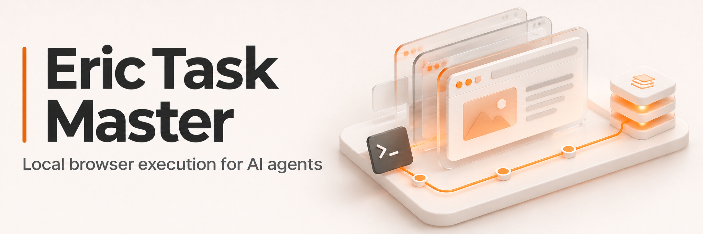

<p align="center">
  
</p>

# Eric Task Master 4.2.1 · 任务大师

**Agent 负责计划和判断，任务大师让浏览器工作持续执行。**

为能调用终端的 AI Agent 提供统一的本机 Chrome 执行接口：批量任务、常驻操作、人工接管和结果保留。运行在你自己的电脑上，复用选定的任务大师 Profile。业务判断来自 Agent，任务大师负责执行与生命周期管理。

[](https://github.com/npcworkspace-cmyk/eric-task-master/releases/latest)
[](https://github.com/npcworkspace-cmyk/eric-task-master/actions/workflows/ci.yml)
[](#下载)
[](LICENSE)

**[下载最新版](https://github.com/npcworkspace-cmyk/eric-task-master/releases/latest)** · [English](README.md) · [4.2.1 发布说明](docs/releases/4.2.1.md) · [Task Master Skills 社区库](https://github.com/npcworkspace-cmyk/eric-task-master-task-pack-skill/blob/main/README.zh-CN.md)

[快速上手](#快速上手) · [执行模式](#两种执行模式) · [下载](#下载) · [文档导航](#文档导航) · [NPC 官网 ↗](https://www.npctech.site/)

---

## 快速上手

1. 从 **[Latest 最新发布](https://github.com/npcworkspace-cmyk/eric-task-master/releases/latest)** 获取运行时和同版 Skill。先安装稳定版 Google Chrome；Node.js 与 Playwright 已包含在运行时中。已有安装时，[先定位，再原位升级](#安装与升级)，保留 Profile 与任务数据。
2. 运行 `taskmaster panel`，保留或选定默认 Profile，把[驱动 Skill](skills/eric-task-master/SKILL.md)交给 Agent。任务需要登录时由你手动完成，自动化开始前关闭手动打开的 Profile 窗口。
3. 保存可信的 `job.mjs`，使用已确认的启动器执行：

```js
export async function run({ page, input, outputDir, progress, signal }) {
  await page.goto(input.url, { waitUntil: 'domcontentloaded' });
  const title = await page.title();
  await progress({ current: 1, total: 1, message: 'Collected title' });
  return { title, outputDir, aborted: signal.aborted };
}
```

```bash
taskmaster run ./job.mjs --input '{"url":"https://example.com"}' --detach --json
taskmaster panel --json
taskmaster follow TASK_ID --wait-ms 60000 --json
taskmaster files TASK_ID --json
```

把 `TASK_ID` 替换为返回的任务 ID，后续 `follow` 带上上次的 `after` 游标。使用 UTF-8 JSON 文件（`--input @ABSOLUTE_FILE`）可避免不同终端的引号差异。`panel --json` 只返回面板地址，不会另开窗口。

## 两种执行模式

| | `batch` | `operations` |
| --- | --- | --- |
| 适合什么 | 已知路径的一次性或重复脚本 | 交互分步、持续观察、条件等待与定时事件 |
| 怎样调用 | 提交小型 `.mjs` | 通过同一 CLI 发送有限 JSON 指令 |
| 何时结束 | 有限任务完成后结束 | 保留任务与 Chrome 上下文，直到停止或达到限制 |
| 共同基础 | 持久 Profile、进度与结果文件 | 相同的 Profile 访问、读回与持久动作证据 |

任务 prompt 明确指定模式时，只覆盖本次任务，不修改 Profile 的默认值。否则按 Profile 策略选择；`auto` 参考 Skill 声明或等待、后续跟进意图，最后回退到 batch。`auto` 是选择策略，不是第三种执行引擎。

人工接管是暂停锁，不是执行模式。它保留浏览器、阻止自动修改；继续需要明确恢复和新的观察，自动化不能自行解除接管锁。切换模式不会切换身份，也不会扩大权限。

## 4.2.1 更新重点

| 更新 | 实际作用 |
| --- | --- |
| 精简决策回复，完整保留证据 | 当前指令返回小型结果，增量观察明确使用基线；完整回执可另行读取，不会重放动作 |
| 稳定的原生目标 | 引用跟随原始连接节点，而不是旧位置；控件替换或脱离页面后明确停止 |
| 更严格的执行边界 | 确认等待前的页面、文档与控制权绑定贯穿实际执行；检查、等待和派发共用单调截止时间 |
| 保留当前场景引用 | 页面长期动态变化时，两级有限缓存仍保留本次观察刚返回的控件 |
| 持久连接与交接记录 | CLI 换连接后沿用同一操作和 Profile；没有原场景缓存的接收端先重新观察 |

以上是文档约定范围内的执行与证据能力，不等于所有网站兼容、不同 AI 之间的理解接力，或外部服务的“恰好一次”保证。详见[发布说明](docs/releases/4.2.1.md)、[输出约定](docs/OPERATIONS-OUTPUT.md)和[持久化说明](docs/OPERATIONS-PERSISTENCE.md)。

## 下载

**新部署统一从 [Latest 最新发布](https://github.com/npcworkspace-cmyk/eric-task-master/releases/latest) 开始。** 运行时和 Skill 必须来自同一次发布，不使用旧本地压缩包替代。下表文件名对应 4.2.1；Latest 更新后，应按新发布的说明和文件名操作。[固定版本 4.2.1](https://github.com/npcworkspace-cmyk/eric-task-master/releases/tag/v4.2.1)仅作为可复现的版本参考，不是未来部署的默认目标。

| 平台 | 原生安装包 | 便携 ZIP |
| --- | --- | --- |
| Windows 10/11 x64 | `eric-task-master-v4.2.1-windows-x64-setup.exe` | `eric-task-master-v4.2.1-windows-x64-portable.zip` |
| macOS Apple silicon | `eric-task-master-v4.2.1-macos-arm64.pkg` | `eric-task-master-v4.2.1-macos-arm64-portable.zip` |
| macOS Intel | `eric-task-master-v4.2.1-macos-x64.pkg` | `eric-task-master-v4.2.1-macos-x64-portable.zip` |
| Debian/Ubuntu x64 | `eric-task-master-v4.2.1-linux-x64.deb` | `eric-task-master-v4.2.1-linux-x64-portable.zip` |
| Debian/Ubuntu arm64 | `eric-task-master-v4.2.1-linux-arm64.deb` | `eric-task-master-v4.2.1-linux-arm64-portable.zip` |

同时下载该 Release 下的同版 `eric-task-master-skill-v4.2.1.zip`、`SHA256SUMS` 和 `UNSIGNED-BUILD.txt`，安装前核对校验和。Windows 和 macOS 包尚未签名；便携 ZIP 也不能绕过 SmartScreen 或 Gatekeeper。

<a id="install"></a>

## 安装与升级

<details>
<summary><strong>定位已有安装、安全替换，并核验升级激活</strong></summary>

### 安装 4.2.1

### 1. 先定位已有安装

新 Agent 部署时，**先检查 Manager，缺少时才安装**。所需版本已部署时，**只给新 Agent 安装或更新 Skill**。旧版经授权后替代升级，不另建第二套 Manager 或替换已有 Profile 池；如果正在工作，由用户选择等待或停止后升级。

通过 Agent 部署或更新时，把[最新版链接](https://github.com/npcworkspace-cmyk/eric-task-master/releases/latest)交给它，并要求安装或更新任务大师及匹配的 Skill。Agent 应核验发布文件并保留已有数据；如果其宿主无法安装或重新加载 Skill，需明确报告该限制。

Windows 使用 Skill 的[只读启动器定位脚本](skills/eric-task-master/scripts/find-launcher.ps1)；macOS/Linux 使用已安装或已知便携目录中的启动器。用 `--help` 确认绝对路径，本次会话继续使用该路径。定位不明确或状态目录报错，不等于可以重新安装、合并数据或重建 Profile。

同一系统用户下的 Agent 默认共用一个选定的 Manager 和 Profile 池。独立项目需要在每条命令中明确传入 `--state-dir ABSOLUTE_DIRECTORY`。常规启动只复用同版本 Manager，不会静默替换不同版本。

**升级只有在启动器、运行中的 Manager 和已安装的驱动 Skill 版本一致时才算完成。** 空闲 Manager 可以自动停止并替代安装；正在工作时，由用户选择等待完成，或明确同意停止其工作后替换，默认不强制停止。新版 Manager 从同版程序包同步选定的已安装 Skill，并保留备份；返回 `not-installed` 时，还须为目标 Agent 导入同版 Skill。非默认 Skill 目录用 `ERIC_TASK_MASTER_SKILL_DIR` 指定。保留 Profile、任务记录与输出，详见[安装说明](docs/INSTALLERS.md)和[状态恢复](docs/STATE-BACKUP-RECOVERY.md)。

Manager 会在旧客户端创建或改变工作之前拒绝它。已识别的 Agent 在 Skill 刷新后必须重新加载新说明才能继续，每个 Agent 分别确认；已有任务的查看和安全停止仍可用。仅装完程序不等于升级激活完成。Windows 已知的旧 `v3` 启动路径会转换为转发入口，让旧终端也进入当前安装；未知或不安全的路径不会被静默修改。

Windows 替代安装器会自动尝试完成激活；返回码 20 表示程序文件已安装，但激活未完成。其他安装包或需要重试时，用新版绝对路径执行 `manager start --upgrade --json`。应实际读回运行中的 Manager 和选定 Skill 版本，不能只凭文件复制成功判断升级完成。

### 2. 下载对应系统的运行时与 Skill

先准备稳定版 Google Chrome，再从 [Latest 最新发布](https://github.com/npcworkspace-cmyk/eric-task-master/releases/latest)选择当前系统的软件包。[下载表](#下载)用于区分包类型；不要混用新版运行时和旧版 Skill 压缩包。

同时下载该 Release 下的 **`eric-task-master-skill-v4.2.1.zip`**、`SHA256SUMS` 和 `UNSIGNED-BUILD.txt`，安装前核对校验和。Windows 和 macOS 包尚未签名；使用便携 ZIP 也不能绕过 SmartScreen 或 Gatekeeper。

运行时包含 Node.js、Playwright、CLI、Dashboard 和后台 Manager，使用本机稳定版 Chrome，不另行捆绑 Chromium。便携包不要求系统安装 Node.js 或管理员安装；解压到固定目录后调用启动器：

```powershell
# Windows 便携版示例
& 'C:\Tools\eric-task-master\bin\taskmaster.cmd' panel
```

```bash
# macOS / Linux 便携版示例
'/absolute/path/eric-task-master/bin/taskmaster' panel
```

### 3. 选定浏览器，把 Skill 交给 Agent

运行 `taskmaster panel`。普通脚本工作应保留已有 Profile，或创建命名 Profile、打开原生 Chrome 窗口、按需登录，关闭手动窗口后选定默认 Profile。不要因为启动器定位出错就替换原有 Profile。

**任务大师的批量和 ops 都使用自己的持久 Profile。** 指定 Profile 或复用已保存的默认项，一个会话可以读取并处理多个标签，不需要每个任务另建 Profile。某个 Agent 选择任务大师还是其他浏览器工具，属于该 Agent 的个人调用规则，不是产品路由。普通 ops 与批量脚本拥有相同的 Profile 访问能力；网站账号选择器和细粒度权限表只是可选约束。实际账号、目标和业务结果仍由 Agent 按用户任务核验。

通过 Agent 的 Skill 管理器导入运行时自带的 `app/skills/eric-task-master/` 或 `eric-task-master-skill-v4.2.1.zip`。采用目录安装时，确认 `SKILL.md` 位于 Skill 根目录；没有 Skill 管理器的 Agent 可以直接读取[驱动 Skill](skills/eric-task-master/SKILL.md)。宣布部署完成前，分别读回 Skill 元数据、绝对路径启动器的 `--help` 和运行中 `manager status --json`，三处均应为 4.2.1。

</details>

## 批量任务的生命周期

[快速上手示例](#快速上手)会按需启动 Manager，并返回任务 ID。省略 `--profile` 时复用已选定的默认 Profile。保留任务 ID 和 `after` 游标，之后查看同一任务，不必重新提交。

只有提交的 `.mjs` 入口会被冻结，旁边的文件不会自动复制；保持脚本自包含，或使用明确的绝对资源路径。重要数据应逐步写入 `outputDir`，不要只在任务结束时保存。

## 开始一个常驻操作

复用选定或默认 Profile，按用户授权的目标开始。普通 ops 不要求网站身份选择器或手工权限表；需要更窄范围时，[操作指南](docs/FAST-OPERATIONS.md)提供账号/资源、域名、允许动作与有效期等可选严格约束。实际网站账号、目标和结果仍由 Agent 核验。示例不构成无关真实账号操作的授权。

```bash
taskmaster ops start --goal "Complete the authorized browser task" --json
taskmaster ops schema --section actions --json
taskmaster ops command OP_ID --input '@observe.json' --json
taskmaster ops get OP_ID --json
taskmaster ops listen OP_ID --after CURSOR --json
taskmaster ops takeover OP_ID --json
taskmaster ops stop OP_ID --json
```

`observe.json` 可以写为 `{ "kind":"observe", "payload":{ "maxChars":6000, "maxItems":40 } }`。首个网址可通过已授权的 navigate 动作打开；操作现有标签的控件前先观察。命令回复自带下一份精简场景，直接复用，不必在每个动作之间重复观察。宿主支持持久 stdin 时，可用 `ops stream OP_ID --json` 保持指令连接，详见[流式协议](docs/OPERATIONS-STREAM.md)。

完成情况必须读取对应回复；持久受理或点击完成不等于业务成功。保留操作 ID、指令/动作 ID 和事件游标；断线后先检查当前状态与未决动作，再继续。`ops stop-all` 只停止常驻操作，不影响无关脚本任务，也不能撤销服务端已经接受的动作。

## 人工验证与结果保留

- 脚本可以进入 `wait({ reason: 'verification' })`：保留 Chrome、请求桌面通知并拍摄有限的诊断截图；20 分钟后暂停，要求人工恢复。
- 页面是否可以继续，由 Agent 或用户判断；任务大师不会自动破解验证码，也不会猜测验证已经解除。
- 结束的任务卡片会离开 Dashboard，但记录和输出仍可通过 CLI 读取，直到明确删除。
- **清理空间**保留登录态、扩展数据和活动任务；历史输出是需要单独勾选的删除类别。

## 小核心，可复用的工作流

```text
Agent + 可选 Skill
        │ 计划、脚本、决策
        ▼
taskmaster CLI → 本机 Manager → Worker → 选定的 Chrome Profile
                      │
                      ├─ 任务状态、进度与结果文件
                      └─ 常驻操作、计划与持久事件

用户 → 本机 Dashboard → 任务控制、Profiles 与人工接管
```

Manager 管进程、Profile 租约、任务状态、进度、结果和清理；脚本与 Skill 管站点行为和业务逻辑。不同 Profile 可以并行，同一个 Profile 同时只有一个写入者。Dashboard 只保留 Tasks 和 Profiles 两个工作视图。Manager 本身不包含模型，也不是一个通用全自主 Agent。

<details>
<summary><strong>常驻操作、定时事件与结果核对如何配合</strong></summary>

同一个任务、Worker 和 Chrome 上下文可以承接多批有限指令：观察指定区域、使用当前页面的有效目标、执行小批动作、确认结果，再等待下一步。本机条件观察器负责安静等待，不必每次轮询都请求模型判断。普通 `.mjs` 仍可直接使用内置 Playwright、CDP、HTTP、Node.js 工具、自定义重试和检查点，不要求注册脚本或网站专属任务类型。

定时计划记录时间、时区、允许执行窗口、有效期和次数限制。错过的工作按有限补偿策略处理，不会无上限补跑。事件区分 **pending、delivered、received、handled**：送达不等于 Agent 已判断，更不等于业务动作成功。

在线 Agent 可以通过 CLI 长轮询接收事件；明确配置的宿主适配器也可以把事件交给另一个进程。可选的[在线 Codex CLI 适配器](docs/CODEX-HOST-ADAPTER.md)使用独立安装、已有登录的 Codex CLI，只在事件到来时调用，并持久记录模型调用额度。目前它只接受白名单范围的**只读观察或安全停止**，不负责发布、发消息或修改业务记录。

常驻操作保留已配置的账号/资源、域名、允许动作和有效期约束。Manager 在执行前记录动作，在外部效果发生前持久确认启动，再通过读回判断预期结果是已确认还是未知。结果不明的写入不会自动重试：必须回到同一授权资源，核对原始预期结果。可选的单次发送传输策略，为明确选定的任务大师 Profile、已知的小型同源 JSON POST 增加有限保护；它和动作记录都不等于外部系统的通用“恰好一次”保证。

</details>

## 发挥你的想象力

调研与公开数据采集、重复网页任务、本机页面监测、经过授权的内容/广告/网站流程、质量检查、下载和归档，都可以从一个小脚本开始。边做边保存有效结果，再把验证过的做法沉淀为可复用 Skill。

能运行本机 CLI、读取 JSON 的 Agent 都可以使用同一约定，包括 Codex、Claude Code、WorkBuddy、Hermes 和 Pi。核心运行时不要求宿主专属插件、MCP 注册或浏览器扩展。这是接口条件，不代表每个宿主、模型或网站都已通过真实使用验收；具体工作流和授权范围仍需单独验证。

## 验证范围与限制

本轮源码变化见 [4.2.1 发布说明](docs/releases/4.2.1.md)。各平台原生安装包、便携包启动和公开下载字节各有独立的[发布验收](docs/RELEASE-GATE.md)，不能用源码测试通过代替。

<details>
<summary><strong>此前的在线宿主证据：4.0.0 验收窗口</strong></summary>

可选在线 Codex CLI 适配器于 2026-11-15 完成 Windows 隔离环境下的一次四小时验收：**14,401,755.9 毫秒**、**238 次采样**、最大采样间隔 **61.01 秒**。两次新的真实 CLI Agent 调用分别完成中断投递后的只读观察，以及拒绝未授权发布并安全停止。适配器空闲模型调用为零，模拟业务写入为零，隔离环境清理通过。定时进入断言复用了此前证据，适配器与核心哈希保持不变，没有复用此前运行时长。

这是源码环境、宿主在线条件下的证据，**不证明**原桌面聊天会被唤醒、电脑休眠或宿主关闭后的恢复、真实平台业务写入，或各平台安装包已经通过。原生安装包、便携包和公开下载文件各自有独立发布验证，详见 [4.0.0 发布说明](docs/releases/4.0.0.md)及[适配器证据与边界](docs/CODEX-HOST-ADAPTER.md)。

</details>

## 信任与安全边界

任务脚本是以当前系统用户权限运行的可信本机代码，不是安全沙箱；可以访问网络与文件系统，只运行你信任的 Agent、Skill 和脚本。常驻操作的安全约束不会把任意脚本变成受限代码。

Manager 仅监听 `127.0.0.1`，对自身诊断做敏感信息脱敏，不自动重放整个失败脚本。分享前仍应检查任务生成的文件与截图。模式、计划、页面指令或适配器回执都不能授予新权限；无法测量的 token 或费用，不能宣称已实现支出控制。

Agent 一轮对话结束后，已提交任务可以继续运行，**前提是本机电脑和运行时仍在运行**。这不代表休眠、关机或 Agent 宿主关闭后仍能执行，也不承诺所有浏览器现场都能在重启后自动恢复。发布新版或更新 Skill，不会让已有安装自动升级。

## 文档导航

| 从这里开始 | 深入了解 |
| --- | --- |
| [安装与升级](docs/INSTALLERS.md) | [状态备份与恢复](docs/STATE-BACKUP-RECOVERY.md) |
| [驱动 Skill](skills/eric-task-master/SKILL.md) | [常驻操作](docs/FAST-OPERATIONS.md) |
| [输出与增量约定](docs/OPERATIONS-OUTPUT.md) | [持久化与证据](docs/OPERATIONS-PERSISTENCE.md) |
| [流式指令](docs/OPERATIONS-STREAM.md) | [可选 Codex 宿主适配器](docs/CODEX-HOST-ADAPTER.md) |
| [4.2.1 发布说明](docs/releases/4.2.1.md) | [构建与发布验收](docs/RELEASE-GATE.md) |

## 一起构建和分享 Skill

[Task Master Skills 社区库](https://github.com/npcworkspace-cmyk/eric-task-master-task-pack-skill)用于分享可复用的流程说明、脚本和结果核验。Skill 不是必需品：先用小脚本把工作做通，再沉淀确实有效的部分。

欢迎提交[工作流想法](https://github.com/npcworkspace-cmyk/eric-task-master-task-pack-skill/issues/new?template=skill-proposal.md)，或按[贡献指南](https://github.com/npcworkspace-cmyk/eric-task-master-task-pack-skill/blob/main/CONTRIBUTING.md)参与。运行时保持通用，专业工作流独立演进。

---

**NPC 核子力文化科技**：甲方操盘手出身的全球公关与品牌团队，也是媒体资源平台「媒介桥」和 AI 工具「任务大师」的打造者。

[了解 NPC ↗](https://www.npctech.site/) · [媒介桥 · npcpressbridge.com ↗](https://npcpressbridge.com/)

## 许可证

MIT
